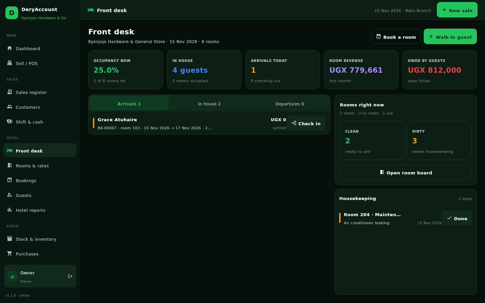
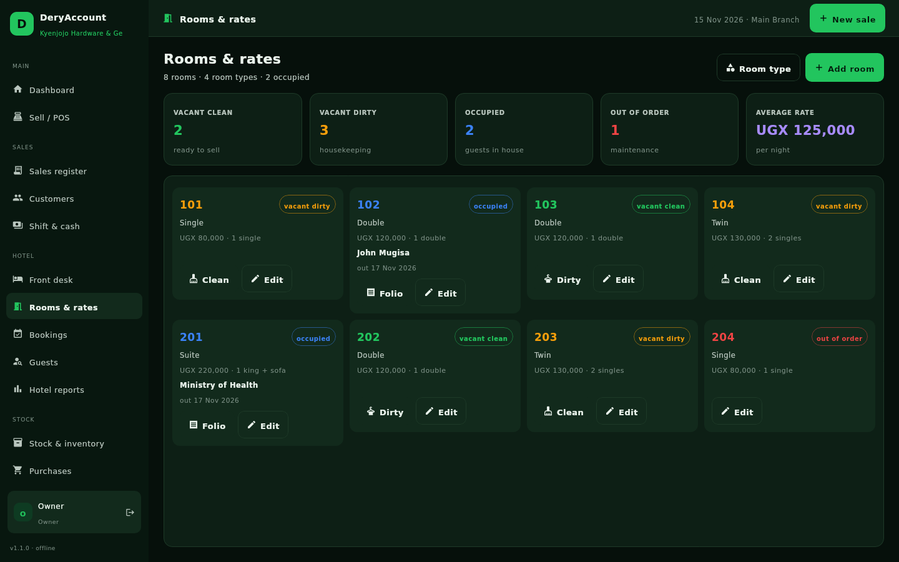

# DeryAccount for Windows

The desktop edition of DeryAccount: the same business, the same books, on a shop
computer instead of a phone. Kotlin + Compose Desktop, packaged as a Windows MSI,
fully offline — one SQLite file holds the whole business.

```
cd desktop
gradle run                     # launch it
gradle test                    # 11 money-flow tests against a real database
gradle packageMsi              # Windows installer (run on Windows)
gradle shots -PshotsDir=out    # render every screen to PNG, no window needed
```

## What is inside

| Area | What it does |
| --- | --- |
| Sell / POS | Barcode or search, favourites, wholesale prices, per-bill discount, MTN / Airtel / credit / bank, change, held bills, PDF receipts |
| Sales register | Every receipt, its lines and payment, PDF reprint, returns with goods back on the shelf |
| Stock | Products, deliveries, physical counts, write-offs, branch transfers, batches with expiry, serial numbers, low-stock alerts |
| Purchases | Supplier deliveries, purchase orders (receive into stock), returns to supplier |
| Customers & suppliers | Credit limits, balances, statements, aging (0-30 / 31-60 / 60+), receipts and payments |
| Expenses | Categorised expenses that post straight to the right ledger account |
| Books of account | Chart of accounts, journal, trial balance, income statement, balance sheet, VAT, manual journal |
| Reports | Daily and monthly sales charts, best sellers, profit by product and category, dead stock, stock valuation, branch comparison |
| Assets & staff | Fixed assets with monthly straight-line depreciation, employees, payroll with deductions, budgets against actual, bank reconciliation |
| Shift & cash | Open a shift with a float, cash in/out, Z-report, close with counted cash and a variance |
| Data | CSV export of any table, CSV import, backup and restore, sample shop |

### Hotel & accommodation
A working front desk for a lodge, guest house or hotel, sharing the same books:

- **Front desk** — today's arrivals, guests in house and departures, with one-click check-in and check-out
- **Rooms & rates** — room types (Single, Double, Twin, Suite) with their own nightly rate and VAT, plus every room number with its condition (clean, dirty, occupied, out of order)
- **Bookings** — the full register: reserve without arriving, walk-in and check in at once, extend a stay, move a guest to another room, cancel, or mark a no-show
- **Folios** — one bill per guest: room nights posted automatically, plus restaurant, bar, laundry and extras charged to the room
- **Guests** — phone, ID, nationality and every past stay
- **Housekeeping** — cleaning and maintenance jobs, with a room marked out of order until the job is done
- **Hotel reports** — occupancy, ADR (average daily rate), RevPAR, revenue by department, and a night-by-night breakdown

How the hotel money moves, and why it stays honest:

| Event | What the books do |
|---|---|
| Deposit or part payment | Dr cash / mobile money · Cr *Guest Deposits Held* (a liability, never income) |
| Guest checks in | Room charges land on the folio only — no revenue yet |
| Guest checks out | Dr guest deposits + debtors + discounts · Cr room revenue, F&B revenue, other services, VAT |
| Company account | The unpaid balance goes to debtors and is collected like any other customer |
| Cancellation | The deposit is refunded (or kept as income for a no-show) and nothing is left owing |

A room can never be sold twice for the same night, and leaving early drops the
unused nights from the bill.

## How the money works

Every sale is one transaction: the bill, its lines, the stock movement, the
customer balance and the journal all land together or not at all. Prices are
VAT-inclusive, so tax is the slice already inside the price, and the ledger keeps
`Dr cash / Dr debtors / Dr discounts = Cr sales + Cr VAT payable` in step. Stock is
valued at cost, so the trial balance always agrees with the shelf.

`gradle test` proves it: the suite covers a cash sale, a credit sale and its
payment, a supplier purchase, VAT, a return, an expense, capital, depreciation,
stock valuation, the sample shop, and twelve hotel cases (deposit held as a
liability, check-out revenue, early check-out, extensions, refunds, no-shows,
double-booking and occupancy maths) — and asserts the balance sheet balances
after every one of them.

## Signing in

First run creates an owner account: **owner / 1234**. Change the PIN (and add a
cashier with the CASHIER role, which hides the books, reports and settings) in
Settings → Users.

## Where the data lives

`Documents/DeryAccount/deryaccount.db` on Windows, `~/.deryaccount/deryaccount.db`
elsewhere. Data & backup copies it anywhere you like; Restore loads it back.

## Screenshots




`docs/screenshots/` holds a render of every main screen, produced by the app
itself (`gradle shots`) with the sample shop loaded.
